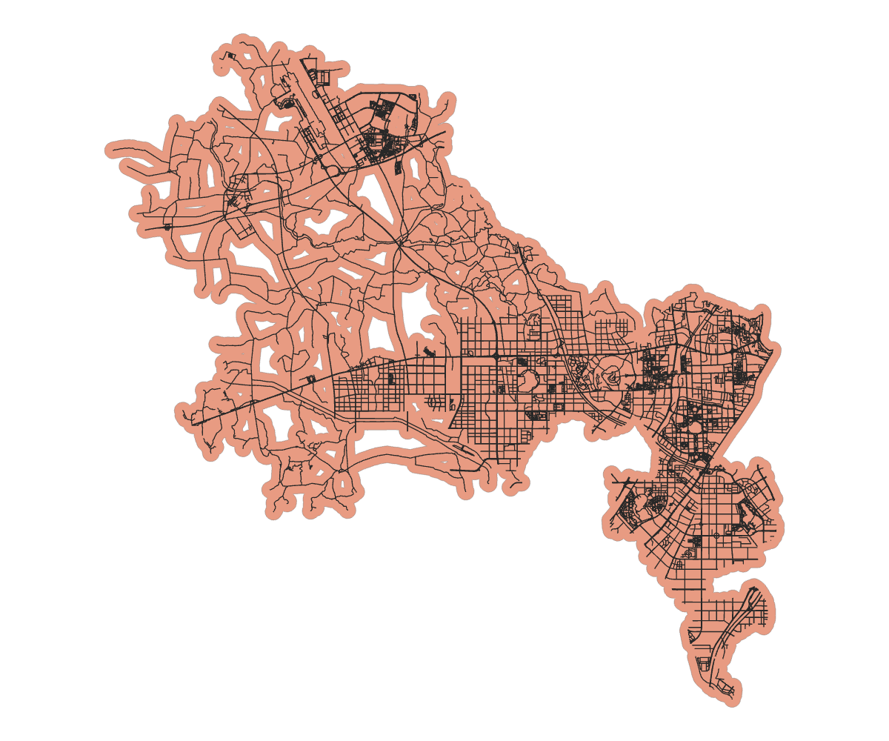

# ArcGIS Pro MCP Server — AI Agent + GIS 工具调用验证 Demo

让大模型（DeepSeek）通过 MCP 协议操作 ArcGIS Pro：读取图层、查询属性、执行空间分析、导出地图。

这是一个**能力验证项目**，用来证明「LLM Agent 可以真正驱动桌面 GIS 工具」这条路走得通。
也是我投递 **AI Builder** 岗位的作品集项目之一，**不是商业产品**，不追求工程完备性。

---

## 项目介绍

ArcGIS Pro 的 `arcpy` 能力很完整，但只能由人手动调用；大模型会推理会规划，却碰不到桌面软件。

这个 Demo 做的就是把两边接起来：

- 用 **MCP（Model Context Protocol）** 把 `arcpy` 的能力暴露成一组工具
- 大模型自己判断该调哪个工具、按什么顺序调、传什么参数
- 结果实时返回给模型，由它决定下一步

验证到的实际效果：给它一句「算一下公路 500 米缓冲带」，它会**先检查坐标系**，发现数据是 WGS84 地理坐标系（单位是度），
主动先投影到 `CGCS2000 3 度带` 再做缓冲——这正是这个项目想证明的东西：不是把命令转发出去，而是能做判断。

---

## 架构


**为什么是两段式，而不是一个 Python 进程？**

因为 ArcGIS Pro 3.1 自带的是 **Python 3.9**，而 MCP 官方 SDK 所有版本都要求 **>= 3.10**，
`pip install mcp` 会被直接拒绝，这条路走不通。

所以拆成两层：Node 负责协议（Node 18+ 无版本问题），Python 只负责执行 `arcpy`，
两者用一行一个 JSON 的管道通信。**这是被环境逼出来的设计，不是过度设计。**

---

## 功能清单

共 **16 个工具**，按用途分五组。

### 环境与工程

| 工具 | 作用 |
|---|---|
| `pro_ping` | 检查 arcpy 是否可用，返回版本、许可级别、Python 版本 |
| `pro_open_project` | 打开 `.aprx` 工程并设为当前工程（几乎其他工具的前置） |
| `pro_project_info` | 工程概况：路径、默认地理数据库、地图与布局列表 |
| `pro_list_maps` | 列出工程内所有地图 |

### 数据查看

| 工具 | 作用 |
|---|---|
| `pro_list_layers` | 列图层（名称、可见性、几何类型、数据源） |
| `pro_describe` | 数据集详情：坐标系、范围、字段、要素数 |
| `pro_list_fields` | 字段清单（名称、别名、类型、长度） |
| `pro_query_attributes` | 读属性表，支持 SQL 条件筛选与行数限制 |

### 空间分析

| 工具 | 作用 |
|---|---|
| `pro_run_geoprocessing` | **万能入口**，可调 ArcToolbox 里绝大多数工具 |
| `pro_buffer` | 缓冲区分析，自动处理输出路径 |
| `pro_clip` | 按边界裁剪 |
| `pro_project_data` | 投影转换（支持 EPSG 或 WKT） |

### 成果输出

| 工具 | 作用 |
|---|---|
| `pro_export_map` | 地图导出 PNG / JPG / PDF |
| `pro_export_layout` | 布局导出 |
| `pro_save_project` | 保存工程到 `.aprx` |

### 兜底

| 工具 | 作用 |
|---|---|
| `pro_run_python` | 执行任意 arcpy 代码片段，预置 `project` / `active_map` / `gdb` 变量 |

> 除此之外 `arcpy.ddd`（3D Analyst）也可通过 `pro_run_geoprocessing` / `pro_run_python` 调用，
> 已实测 `FeatureTo3DByAttribute`、`InterpolateShape`、`SurfaceVolume`、`Skyline`、`LineOfSight` 等。

---

## 环境说明

| 组件 | 要求 | 说明 |
|---|---|---|
| 操作系统 | Windows 10 / 11 | 未在 Linux / macOS 验证 |
| ArcGIS Pro | 3.x（本机验证于 **3.1**） | **必须安装且有可用许可**，Basic 许可部分工具受限 |
| Node.js | **>= 18**（推荐 20+） | 承担 MCP 协议层 |
| Python | **3.9**，用 Pro 自带的 `arcgispro-py3` | 不要用系统 Python，它没有 arcpy |

`arcgispro-py3` 的典型位置（脚本会自动探测）：

```
C:\Program Files\ArcGIS\Pro\bin\Python\envs\arcgispro-py3\python.exe
D:\ArcGIS\bin\Python\envs\arcgispro-py3\python.exe
```

也可以用环境变量显式指定：

```bat
set ARCGIS_PRO_PYTHON=C:\Program Files\ArcGIS\Pro\bin\Python\envs\arcgispro-py3\python.exe
```

---

## 部署步骤

**1. 准备环境**

安装 ArcGIS Pro（并登录使许可生效）+ Node.js 18 以上。

**2. 拉取代码并安装依赖**

```bash
git clone https://github.com/xiaohuajia2005/arcgis-pro-mcp-demo.git
cd arcgis-pro-mcp-demo
npm install
```

**3. 运行自检**

```bash
node doctor.mjs
```

正常输出：

```
1. 检查运行环境
  [OK]   Node v24.22.2
  [OK]   ArcGIS Pro Python: D:\ArcGIS\bin\Python\envs\arcgispro-py3\python.exe
  [OK]   server.mjs 存在

2. 启动 MCP 服务并握手
  [OK]   MCP 握手成功

3. 检查工具注册
  [OK]   工具数量 16

4. 检查 arcpy 是否可用
  [OK]   arcpy 可用 {"arcpy":"3.1.5","license":"ArcInfo",...}

全部通过，服务可用。
```

失败时会指出断在哪一层，对照 `docs/TROUBLESHOOTING.md` 处理。

**4. 配置 MCP 客户端**

通用格式参考 `config/mcp-config.example.json`，DeepSeek Harness 参考 `config/deepseek-harness.example.yml`。

以 Harness 为例，编辑 `%USERPROFILE%\.dsh\profiles\desktop\cordis.patch.yml`，追加：

```yaml
- insert:
    - id: "mcp-arcgis-pro"
      name: "@deepseek-ai/dsh-mcp-client"
      config:
        serverName: "arcgis-pro"
        transport: "stdio"
        command: 'C:\Program Files\nodejs\node.exe'   # 换成你的 node 路径
        args:
          - 'D:\arcgis-pro-mcp-demo\server.mjs'       # 换成你的实际路径
```

**5. 重启客户端**

配置**必须重启**才会加载。重启后在对话里说「用 pro_ping 检查一下 ArcGIS 环境」，能返回 arcpy 版本即接通。

**6. 开始使用**

```
帮我打开 D:\data\demo.aprx，看看有哪些图层
```

---

## 演示截图

### 公路 500 米缓冲区（由 Agent 自主完成）



这张图是 Agent 独立走完整个流程产出的，中间没有任何手动干预：

| 步骤 | Agent 的决策 | 调用工具 |
|---|---|---|
| 1 | 先看图层清单，确认数据在哪 | `pro_list_layers` |
| 2 | 检查坐标系，发现是 WGS84（单位：度） | `pro_describe` |
| 3 | **判断直接按米缓冲会出错**，先投影到 CGCS2000 3 度带 | `pro_project_data` |
| 4 | 做 500 米缓冲并溶解（否则会碎成 7943 个独立面） | `pro_buffer` |
| 5 | 导出成图 | `pro_export_map` |

第 3 步是重点：如果不投影，ArcGIS 会把「500 米」当成 0.0000045 度去算，结果完全错误。
Agent 自己发现了这一点。

---

## 已知局限

如实说明，这些不是"待优化项"，是当前架构下的硬性限制：

**1. 只能本地运行**

stdio 子进程模型，没有网络服务、没有鉴权、没有并发控制。单用户单会话可用，不能部署成多人共享服务。

**2. 强依赖 ArcGIS Pro 授权**

没有 Pro 和有效许可，`import arcpy` 直接失败。这不是能靠代码绕过的限制——`arcpy` 的几何运算和地理处理都跑在 Esri 的运行时里。

**3. 运行时必须分开，不能合并成一个进程**

Node 跑协议、Python 跑 arcpy。原因见上文：Pro 自带的 Python 3.9 装不上 MCP SDK。
理论上可以用独立 Python 3.10+ 环境跑 MCP，但那个环境里没有 arcpy，仍然要跨进程调用，复杂度不会更低。

**4. 操作的是 `.aprx` 文件，不是你正打开的 Pro 窗口**

`arcpy.mp.ArcGISProject("CURRENT")` 只在 Pro 进程内部有效，外部进程拿不到。
而且 **Pro 打开工程时会独占锁定 `.aprx`，此时外部写入会失败**（`OSError`）。
实践建议：只在 Pro 关闭工程时让 Agent 写入；只读类操作（查询、统计、临时分析）不受影响。

**5. 无法精确控制出图范围**

独立进程没有渲染视图，`view.camera` 的读写会失效甚至让进程挂死，改 CIM 相机也无效。
现在的做法是新建地图让其自动贴合图层范围，所以只能出「整层范围」的图，做不了局部特写裁剪。

**6. 部分工具性能差**

实测 `Buffer3D` 处理 234 条线耗时 **429 秒**（同样数据做 2D 缓冲不到 1 秒），
它要逐要素构造 MultiPatch 实体。大数据量的 3D 操作需要先抽样验证。

**7. 验证范围有限**

只在 **Windows + ArcGIS Pro 3.1 + ArcInfo 许可** 上完整跑通过。
其他版本、Standard/Basic 许可下的工具可用性未逐一验证。

---

## 技术难点记录

这部分是这个项目真正的价值所在——都是实际卡住过、最后解决掉的问题。

| 问题 | 现象 | 解决方式 |
|---|---|---|
| Python 版本卡死 | `pip install mcp` 全部版本被拒，提示要求 >= 3.10 | 改双进程架构，Node 承担协议层 |
| 协议通道被污染 | arcpy 大量向 stdout 打印，JSON 通道被冲垮，客户端解析失败 | worker 启动时把 fd 1 复制给协议专用流，再把真正的 stdout 重定向到 stderr |
| 图层名不被 GP 工具接受 | `GetCount("湖泊")` 报"数据集不存在" | 服务端把图层名自动解析成数据源路径再传入 |
| 独立进程拿不到活动地图 | `project.activeMap` 返回 `None` | 兜底取第一个地图，并在文档中提示显式传 `map_name` |
| `Buffer` 参数顺序记错 | 报 `ERROR 000800`，边类型收到 `NONE` | 查证第 4 位是边类型、第 5 位才是端点样式，修正调用 |
| 视图对象不能缓存 | 导出空白图（7 KB） | 每次导出重新获取 `defaultView` |
| 保存工程失败 | `OSError: <aprx 路径>` | Pro 独占锁导致，改为提示用户先关闭工程 |

---

## 目录结构

```
arcgis-pro-mcp-demo/
├── server.mjs                    # MCP 协议层，16 个工具的定义与调度（Node）
├── arcpy_worker.py               # arcpy 执行进程，一行一个 JSON（Python 3.9）
├── doctor.mjs                    # 分层自检脚本，排查"看不到工具"
├── start-mcp.bat                 # 一键启动，用于手动验证
├── package.json
├── config/
│   ├── mcp-config.example.json   # 通用 MCP 客户端配置样例
│   └── deepseek-harness.example.yml  # DeepSeek Harness 配置片段
├── docs/
│   ├── TROUBLESHOOTING.md        # 常见故障与处理
│   └── screenshots/
│       └── buffer-500m.png
└── README.md
```

---

## 说明

本项目为个人能力验证 Demo，用于 AI Builder 岗位的作品展示。
代码以「跑通链路、验证可行性」为目标，未做生产级加固（无测试覆盖、无错误重试策略、无并发处理）。

示例数据为公开的 OpenStreetMap 道路与水系，以及公开 DEM，不含任何敏感信息。

## License

MIT
